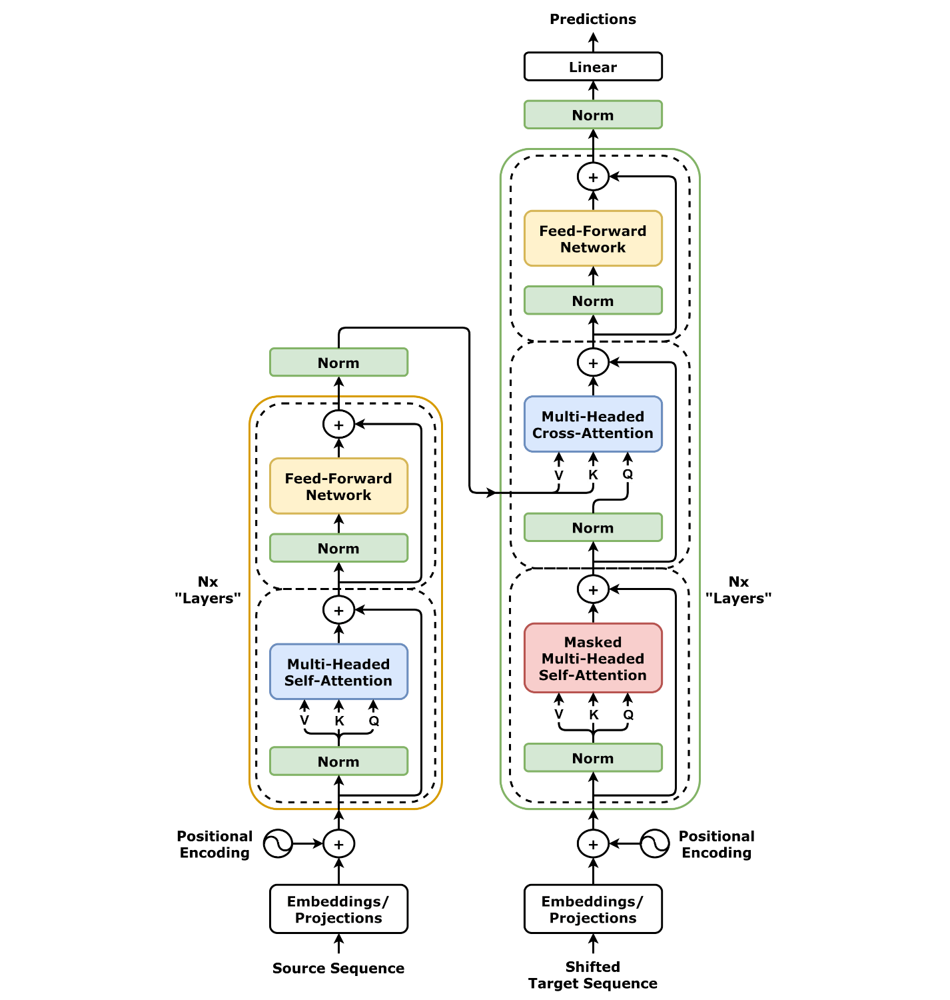

# Transformer-NMT
Implementing a Transformer model from scratch using PyTorch for the task of Machine Translation

Configurations of the model:
1. No of layers - 6
2. Noam Schedular vs Constant LR
3. Scaled vs Unscaled Attention
4. Sinosudial vs Learned Positional Embeddings

How to run the script:
Run ```python3 -m src/train```



[Wandb Report](https://wandb.ai/da25m022-iit-madras/da6401-a3/reports/Assignment-3-Report--VmlldzoxNjgzODMwMA?accessToken=b3tnvfx6ehq6f5sdi2wkymxcbzxnwwl5pduwkrljx7zyg8gtf2933zfrluuf0jrd)